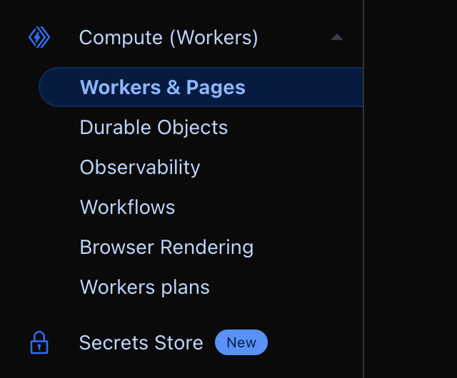
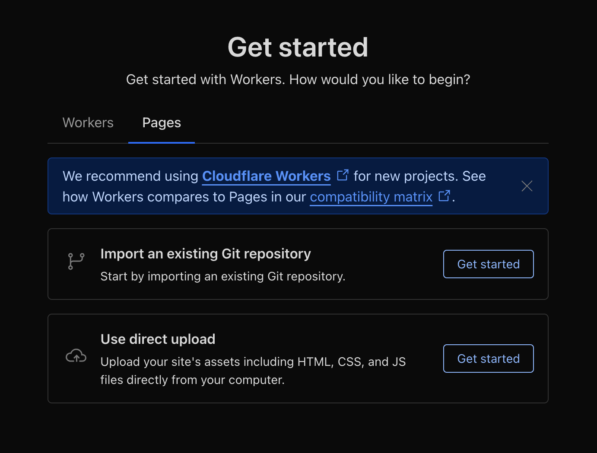
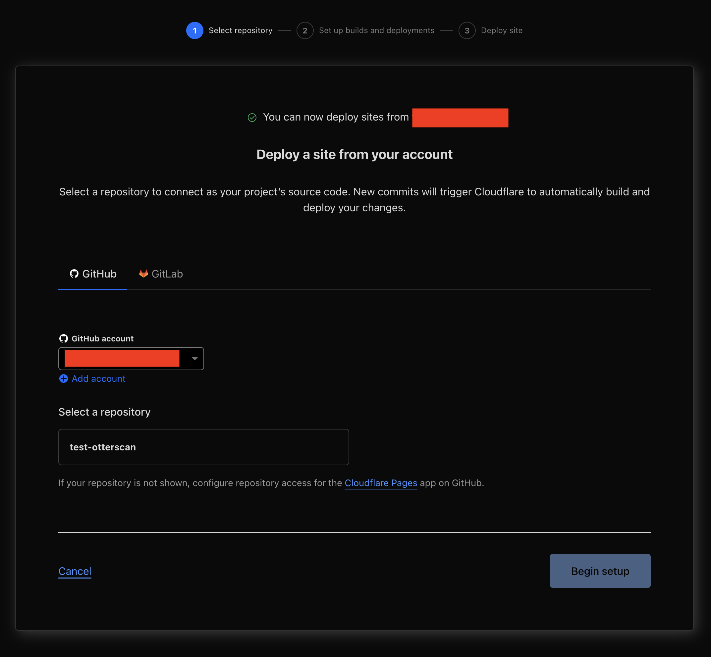
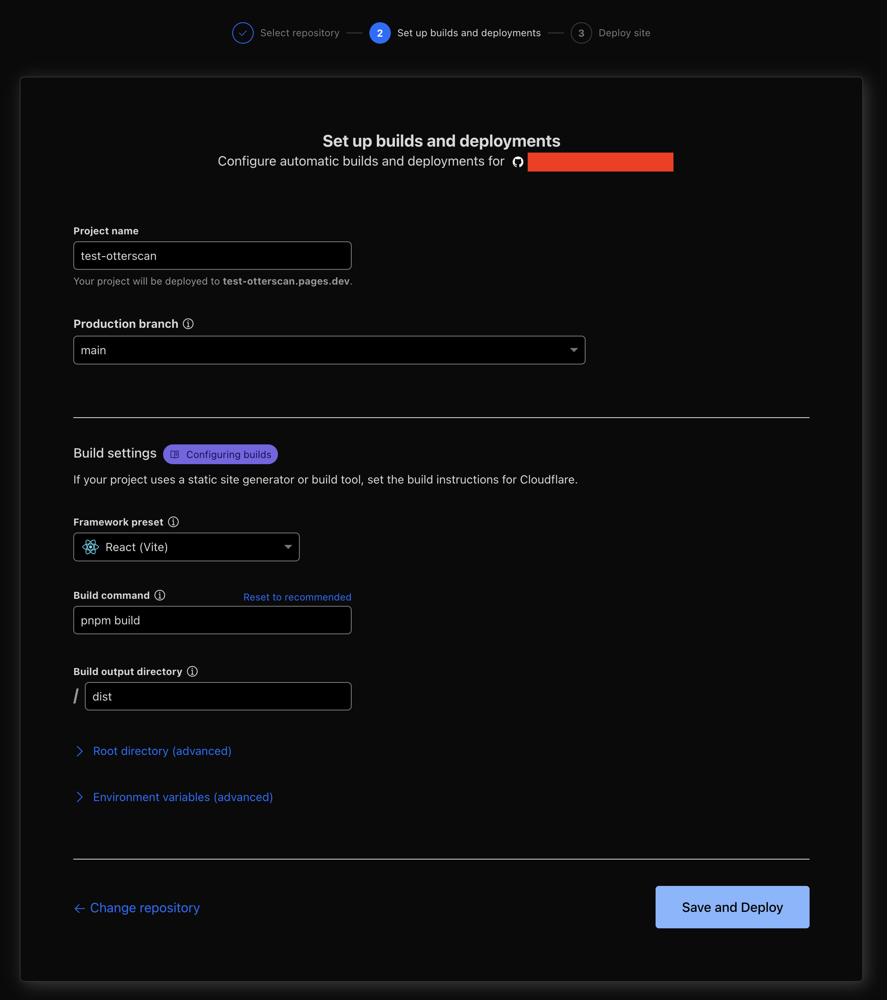
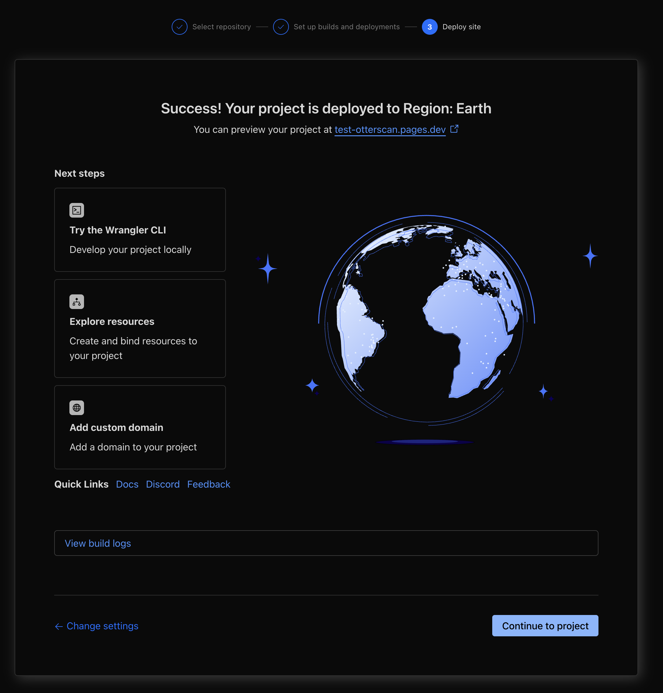
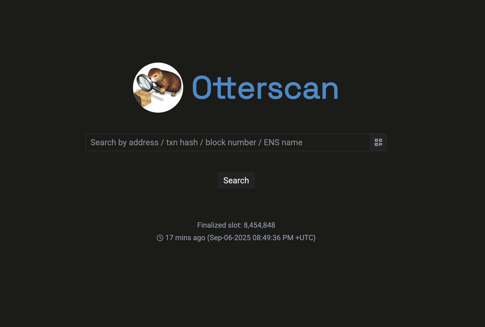

# Hosting Otterscan on Cloudflare Pages

This is a small guide to host an instance of Otterscan on [Cloudflare Pages](https://pages.cloudflare.com/), a free hosting service.

> 💡 This guide is for educational purposes. Advanced topics like security hardening or Cloudflare account management will **NOT** be addressed here.

## Deploying an Otterscan instance

The following steps will assume you:

- Already have an active Cloudflare account.
- Already have an active GitHub account.
- Already have an Erigon archive node running.

### Repository configuration

Assuming:

- You can access your Erigon node JSON-RPC on `http://my-erigon-url:8545`
- You can access your Erigon node beacon-API REST endpoint on `http://my-erigon-url:5555`

> 💡 Make sure CORS settings are working for both endpoints!

Do:

1. Go to <https://github.com/otterscan/otterscan> and fork it to your account.
2. Clone the forked repository to your machine.

```sh
git clone 
```

3. Checkout the stable branch `main`.

```sh
git checkout main
```

4. Using your favorite code editor, create a `.env.production` file at the root of the repository.
5. Paste the following contents:

```json
VITE_CONFIG_JSON='
{
  "erigonURL": "http://my-erigon-url:8545",
  "beaconAPI": "http://my-erigon-url:5555",
  "assetsURLPrefix": "https://static.otterscan.io",
}
'
```

6. Commit and push to your repository.

Now you have a clone of Otterscan ready to be deployed according to your configuration. Let's proceed to deploying it on Cloudflare.

### Cloudflare configuration

1. Open the [Cloudflare dashboard](https://dash.cloudflare.com/) and go to the **Workers and Pages** section.

    

2. Select **Create** -> **Pages** -> **Import an existing Git repository**.

    

3. Select your fork of Otterscan. You will have to authorize Cloudflare to access your GitHub account.

    

4. Configure the deployment.

    - On production branch select the branch where you pushed your `.env.production` configuration file.
    - Select **React (Vite)** on **Framework preset**.
    - Change the **Build command** to `pnpm build`.
    - Don't change the other settings.

    

5. Cloudflare will now proceed to build and deploy from your GitHub repository to a private domain *project-name*.pages.dev.

    

> ⚠️ The `*.pages.dev` domain Cloudflare gives you is public and anyone who knows it can access your application.

6. You should now be able to open *project-name*.pages.dev in your browser and it'll open Otterscan making use of your configure Erigon node.

    

> Due to how [Cloudflare Pages work](https://developers.cloudflare.com/pages/configuration/serving-pages/#single-page-application-spa-rendering), it'll be recognized as an SPA and routing will be automatically handled for you.

## What now?

Congratulations! You now have a working Otterscan instance! 🎉

There are other things you can do from here:

- Configure a [custom domain](https://developers.cloudflare.com/pages/configuration/custom-domains/).
- Setup deployment pipelines for production/development instances on Cloudflare Pages.
- Configure more aggressive caching.
- Add other [configuration options](../config/options/) to the `.env.production` file.